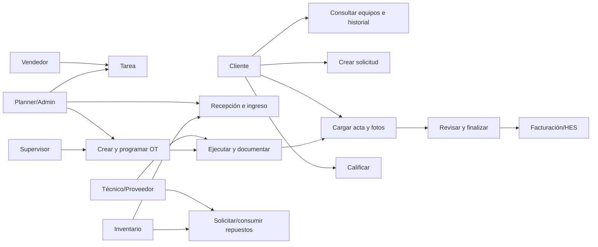
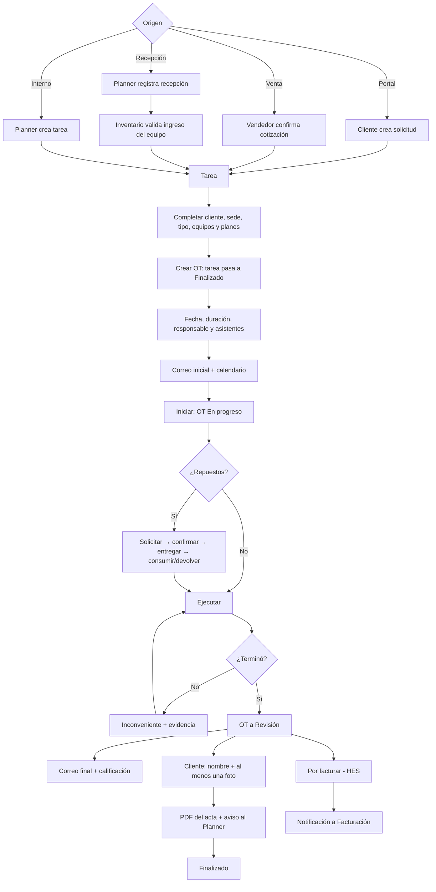
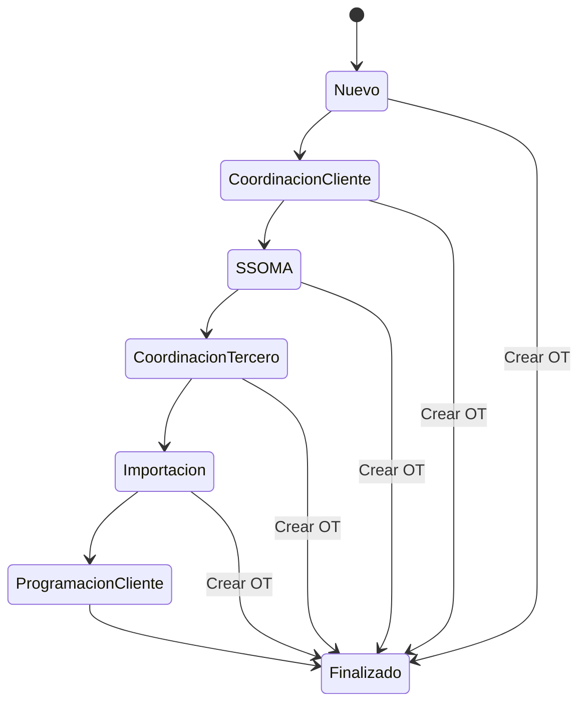
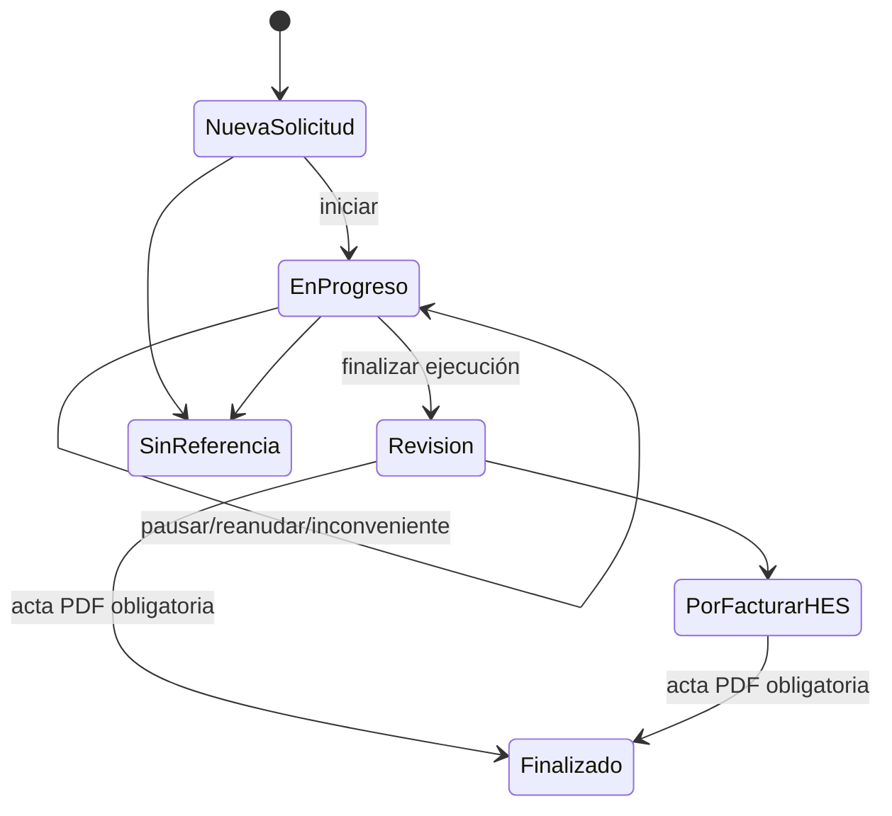
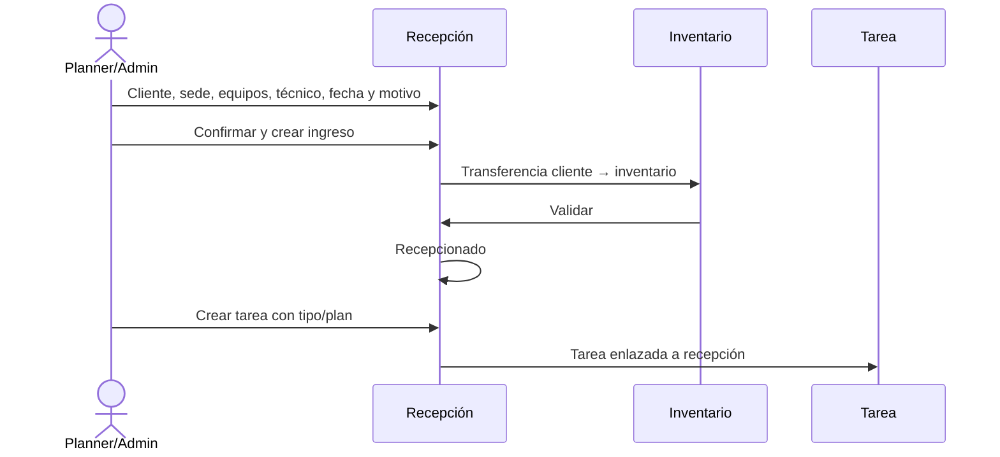
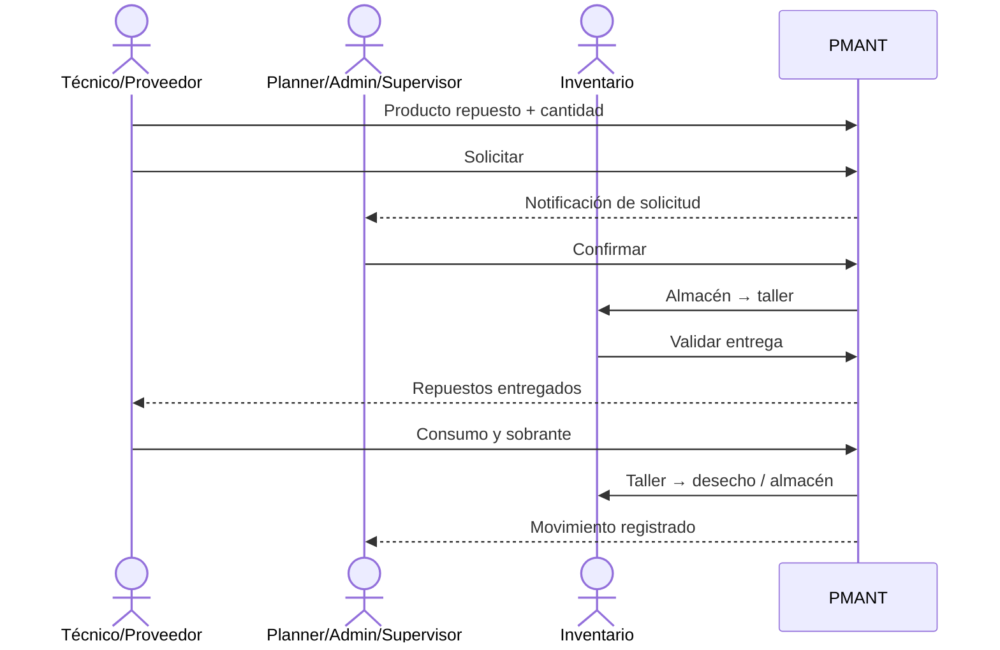

# PMANT — procesos, usuarios, datos y comunicaciones

Documento construido desde el código del módulo `pmant`. Describe lo implementado actualmente.

## Actores

| Actor | Responsabilidad implementada |
|---|---|
| Cliente portal | Consulta equipos e historial, crea solicitudes, completa listas/mediciones disponibles, carga conformidad y califica. |
| Vendedor | Confirma una cotización; si contiene equipos, genera una tarea para revisión. |
| Planner | Completa la tarea, crea/programa OT, coordina recepción y repuestos, revisa el acta y cierra. |
| Administrador | Acceso funcional amplio, incluida configuración, recepción e inventario PMANT. |
| Supervisor | Supervisa tareas/OT y puede confirmar repuestos. |
| Técnico | Ejecuta trabajos asignados, registra horas, evidencias, inconvenientes y repuestos. |
| Proveedor | Usuario interno restringido a PMANT y a trabajos asignados; ejecuta y documenta el servicio. |
| Inventario | Valida ingresos, entregas, consumos, desechos y devoluciones mediante transferencias. |
| Facturación/HES | Recibe OT derivadas a `Por facturar - HES`. |
| Sistema | Secuencias, eventos, correos, notificaciones, recordatorios y sincronización offline. |

## UML de casos de uso

## Proceso principal

## Qué debe rellenar cada usuario

### Cliente portal

| Caso | Datos/acción |
|---|---|
| Solicitud | Equipo y descripción/motivo, más los campos visibles configurados en el portal. |
| Checklist | Respuestas y mediciones de la plantilla vinculada. |
| Conformidad | **Nombre de quien da conformidad** y **una fotografía como mínimo**. Documento y notas son opcionales. |
| Calificación | Valoración desde el enlace del correo. |

### Vendedor

- Cliente, sede/dirección de entrega, título de cotización, líneas de servicio y equipo asociado.
- La venta general crea una tarea sin tipo ni plan: el Planner debe completarlos.
- La variante de inspección asigna el tipo Inspección, pero también necesita planes antes de crear OT.

### Planner / Administrador

| Caso | Datos obligatorios/necesarios |
|---|---|
| Tarea | Nombre, compañía, cliente, sede, tipo, equipos y un plan por equipo. `Crear OT` bloquea si falta tipo o plan. |
| Programación | Fecha/hora, duración, responsable y, cuando corresponda, asistentes/subordinados. |
| Recepción | Cliente, sede, equipos, técnico responsable, fecha/hora y motivo. |
| Configuración recepción | Ubicación cliente, ubicación inventario y operación de entrada en `conf.pmant.ubicacion`. |
| Repuestos | Producto marcado `Es un repuesto`, cantidad, almacén, taller, operación interna y ubicación de desecho. |
| Cierre | Revisar reporte/evidencias/acta. `Finalizado` exige el PDF de conformidad. |

### Técnico / Proveedor

- Inicia el servicio; se abre la sesión/hoja de horas y la OT pasa a `En progreso`.
- Registra pausas, reanudaciones, observaciones, checklist, mediciones y evidencias.
- Si no termina, registra inconveniente, comentario y archivo/evidencia.
- Agrega cantidades de repuestos antes de solicitar; después registra consumo y notas permitidas.
- Finaliza mediante el asistente; se cierra la sesión y la OT pasa a `Revisión`.
- El modo offline admite OT en `Nueva solicitud` o `En progreso`.

### Inventario

- Recepción: valida cliente → inventario; la recepción pasa a `Recepcionado`.
- Repuestos: valida almacén → taller; PMANT actualiza lo entregado y avisa a asignados.
- Resultado: consumo taller → desecho y sobrante taller → almacén.

## Tipos de servicio

`tipotarea.mantenimiento.service_kind` implementa:

| Tipo | Diferencia real en código |
|---|---|
| Inspección | Activa `Es inspección` y tiene una creación especial desde ventas. |
| Mantenimiento preventivo | Clasificador estándar; usa el flujo común. |
| Mantenimiento correctivo | Clasificador estándar; usa el flujo común. Repuestos no están restringidos solo a este tipo. |
| Evaluación | Clasificador estándar; no tiene un flujo exclusivo completo. |
| Otro | Clasificador para casos no cubiertos; usa el flujo común. |

Todos necesitan tipo y plan por equipo para crear OT. Programación, ejecución, repuestos, acta y cierre dependen del estado/configuración, no del tipo.

## Estados UML

### Tarea

Estados: Nuevo, En coordinación con cliente, SSOMA, Coordinación con tercero, Importación, Programación de servicio con cliente y Finalizado.

### Orden de trabajo

Los estados activos son Nueva solicitud, En progreso, Revisión, Por facturar - HES, Finalizado y Sin referencia / Sin responsable. Los históricos `Reparado` y `Desechar` se migran a `Finalizado`.

## Recepción de equipos

Reglas: sede del mismo cliente; equipos de la compañía; categoría con producto; si el producto tiene seguimiento, el equipo necesita serie/lote. Solo Planner o Administrador confirma/cancela y crea tareas. La plantilla de correo de hoja de recepción existe, pero no está conectada a un envío automático.

## Repuestos

Se controlan cantidades solicitadas, entregadas, consumidas, devueltas y desechadas. Conviven el sistema nuevo `pmant.spare.line` y el legado `requerimientos.stock`; es una deuda técnica que podría duplicar conceptos si se reactivan vistas antiguas.

## Correos y notificaciones

### Correos

| Disparador | Destino | Se envía |
|---|---|---|
| Programación inicial | Email de sede | OT/título, cliente, sede, tipo, fecha, duración, responsable, asistentes y enlaces. |
| Reprogramación | Sede; copia empresa según plantilla | Nueva fecha y datos de OT. |
| Botón correo a Empresa | Empresa | Programación y PDF mediante compositor. |
| Botón correo a Sucursal | Sede | Programación y PDF mediante compositor. |
| OT entra a Revisión | Sede | Reporte/servicio finalizado. |
| OT entra a Revisión | Sede | Correo separado de calificación. |
| Alarma de tarea tipo email | Según plantilla | Recordatorio de fecha planeada. |
| Evento de próximo servicio | Asistentes | Invitación de calendario. |
| Hoja de recepción | Nadie automáticamente | Plantilla disponible, sin disparador Python encontrado. |

### Notificaciones internas

| Evento | Receptor |
|---|---|
| OT asignada/reasignada | Responsable. |
| Cambio de estado por otra persona | Responsable. |
| Solicitud portal | Planner y Administrador. |
| Repuestos agregados/solicitados | Creador o Planners. |
| Entrega validada | Asignados a la OT. |
| Consumo/devolución | Planner y creador. |
| Acta cargada | Planner/creador + actividad `Por hacer`. |
| Por facturar - HES | Grupo de notificación de facturación. |
| Alarma tipo popup | Planners activos; Admin de respaldo. |

## Permisos resumidos

| Acción | Admin | Planner | Supervisor | Técnico | Proveedor | Portal |
|---|:---:|:---:|:---:|:---:|:---:|:---:|
| Configurar | Sí | Amplio | Limitado | No | No | No |
| Crear OT | Sí | Sí | Sí | No | No | No |
| Ejecutar asignada | Sí | Sí | Sí | Sí | Sí | No |
| Confirmar recepción | Sí | Sí | No | No | No | No |
| Confirmar repuestos | Sí | Sí | Sí | No | No | No |
| Validar stock | Sí* | Sí* | Con grupo Inventario | Con grupo Inventario | No | No |
| Ver equipos | Sí | Sí | Sí | Sí | Lectura | Solo su empresa |
| Conformidad/calificación | Enlace | Enlace | Enlace | Enlace | Enlace | Sí |

`*` Admin y Planner heredan `stock.group_stock_user`.

## Automatizaciones y brechas

- Al confirmar ventas con equipos se crea una tarea; el Planner debe completar tipo/planes.
- Crear OT finaliza la tarea, asigna secuencia, programa evento y envía el correo inicial.
- Inicio/fin actualizan etapa, sesiones y programación.
- La conformidad genera PDF, adjunto, mensaje, notificación y actividad.
- Cron de alarmas de tarea usa `America/Lima` y evita duplicado básico por minuto; también hay alarmas CRM.
- El correo de recepción no se dispara automáticamente.
- Preventivo, Correctivo, Evaluación y Otro no tienen validaciones particulares completas.
- El nuevo flujo de repuestos sirve para todos los tipos, no solo Correctivo.
- Supervisor necesita permisos estándar de Inventario para validar transferencias.
- Sin acta del cliente la OT no puede pasar a Finalizado.
- Correos requieren emails válidos y URL base/portal correcta.

## Archivos fuente

- Tipos, tarea y creación de OT: `models/tarea.py`, `data/task_type_data.xml`.
- OT/programación/correos: `models/ots.py`, `models/hoja_horas.py`, `views/email/`.
- Ejecución: `wizard/incovenientes.py`, `models/offline.py`, `controllers/offline.py`.
- Recepción: `models/reception.py`, `views/reception.xml`.
- Repuestos: `models/spare_parts.py`, `views/spare_parts.xml`; legado en `models/stock_task.py`.
- Conformidad: `models/work_order_conformity.py`, `controllers/conformity.py`.
- Portal: `controllers/portal.py`, `models/solicitudes.py`.
- Notificaciones/cron: `models/notifications.py`, `models/alert_maintenance.py`, `views/alert_notification/action_alarm.xml`.
- Venta y seguridad: `models/ventas_mant.py`, `security/security.xml`, `security/ir.model.access.csv`.

